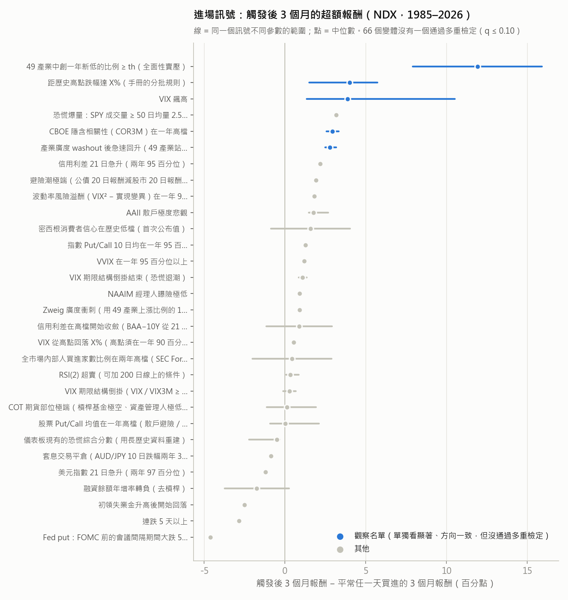
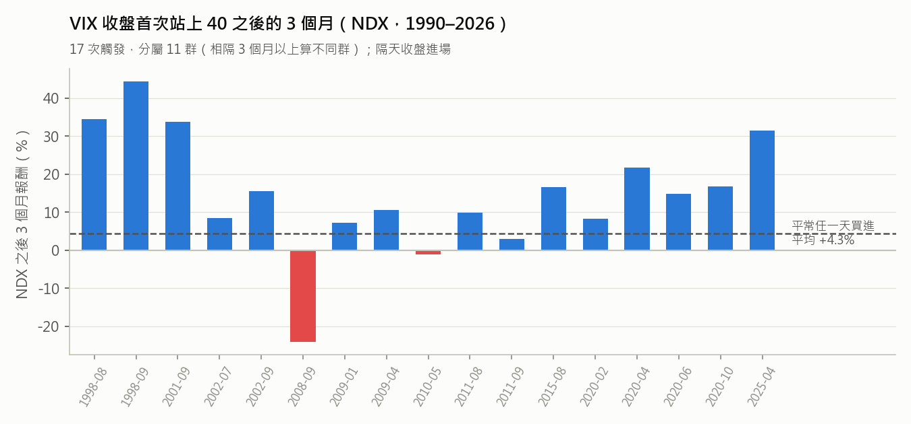
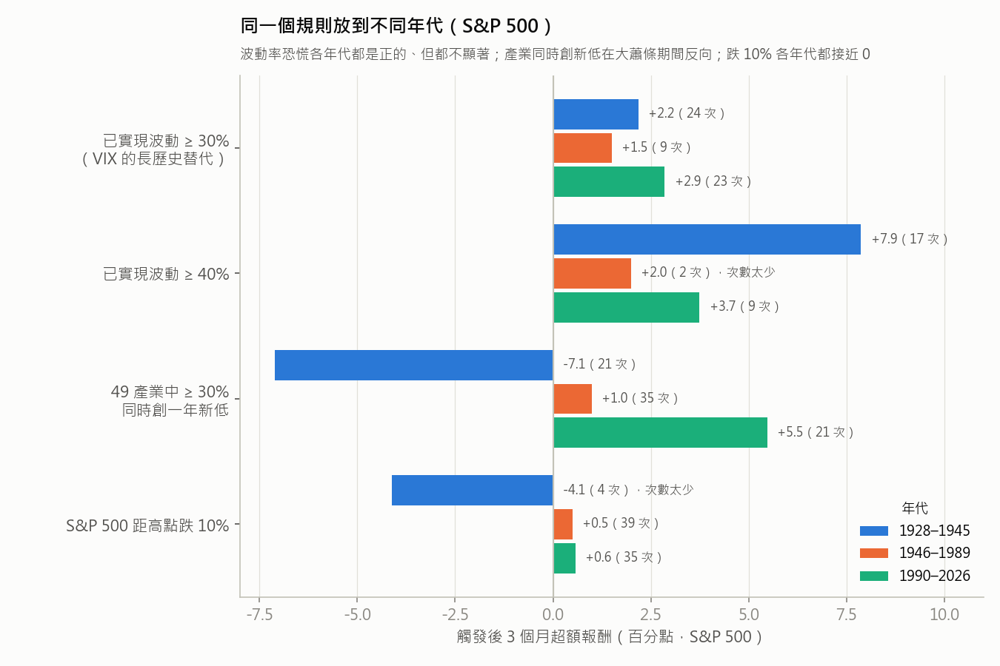
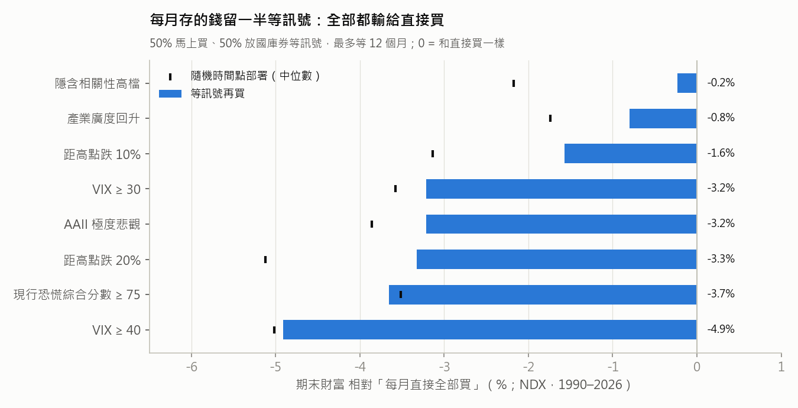
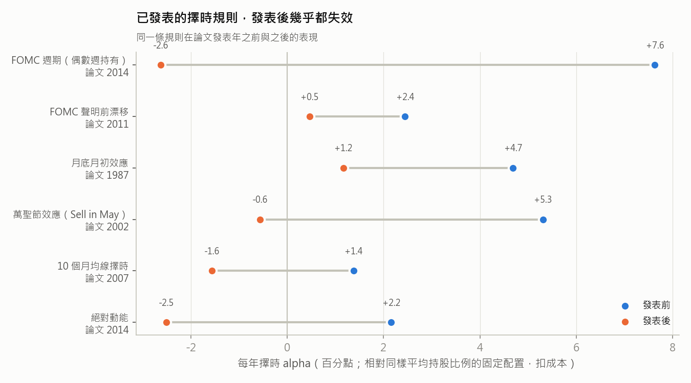

# 美股進出場訊號研究報告（第一階段）

**日期：** 2026-10-19
**標的：** QQQ（用 Nasdaq-100 指數把歷史延伸到 1985 年），並用 S&P 500（1928 年起）做交叉驗證
**資料截止：** 2026-10-16（部分資料源較早結束，見第 2 節）
**性質：** 給你自己參考的歷史機率與脈絡，**不是投資建議**。沒有連接券商，也沒有下單。

---

## 0. 先講結論

1. **測了 106 個訊號變體**，涵蓋籌碼、情緒、期權、波動率、信用、廣度、內部人、COT、總經、跨資產、季節性、FOMC 事件等類別。其中 66 個是「進場事件」，40 個是「擇時／出場規則」，每個都在 NDX 和 S&P 500 上各跑一次。
2. **在嚴格標準下，沒有任何一個訊號通過驗證。**
   - 進場訊號：單獨看最顯著的 p 值在 0.004–0.02 之間，但一次測 66 個變體，多重檢定後最好的 q 值只有 0.25（門檻是 0.10）。
   - 出場／擇時規則：40 個全部淘汰。
3. **但有一個方向反覆出現：在「全面恐慌」時買，之後 3 個月通常比平常好。**
   - 最有代表性的是 **VIX 收盤 ≥ 40**：17 次觸發，之後 3 個月 NDX 平均比平常多 10.5 個百分點。
   - 樣本內、樣本外、S&P 500、小型股、新興市場、晚一天進場，方向都一致。
   - 1990 年以前沒有 VIX，用「已實現波動」代替，1928–1989 年也是正的，只是不顯著。
   - 冷門的「CBOE 隱含相關性（COR3M）在一年高檔」也有類似結果，但它 2006 年才有資料。
   - 這些都列為**觀察名單**，不是通過驗證的訊號。
4. **對你最重要的發現：每月存的錢，不要留著等恐慌再買。**
   - 「一半直接買、一半放現金等訊號」的做法，用任何一個訊號（包括 VIX ≥ 40），期末財富都比「全部直接買」少 0.2%～4.9%（NDX，1990–2026）。
   - 原因是等待期間在現金裡損失的上漲，大過抓到好買點的好處。這個結論不依賴 p 值，所有測試都一致。
   - 恐慌訊號比較合理的用途是：**平常照固定比例持有，恐慌出現時從現金桶「暫時加碼」**。歷史上每年大約多 0.5～0.9 個百分點。以 VIX ≥ 40 為例，拿掉 2009、2020 兩年後只剩 0.5 個百分點（t = 1.7），統計上不顯著。
5. **出場：不建議用任何訊號擇時賣出。**
   - 趨勢、波動率目標這類規則能大幅降低最大回撤（NDX 從 −83% 降到 −35%～−57%），但報酬也一起變少。和「持股比例一樣、但固定不動」的配置比起來，沒有多賺；2013 年以後還比較差。
   - 已經有人發表過的擇時規則，發表後幾乎都失效（圖 3）。
6. **儀表板現有的「恐慌綜合分數」沒有歷史優勢。**
   - 用 1986–2026 的資料重建後，分數 ≥ 75 之後的 3 個月報酬和平常差不多（−0.3 個百分點）。
   - 只有 2013 年後是正的。先前研究看到的優勢，主要來自 2011–2026 這段 V 型反彈很多的期間。
   - 它的組成指標（Put/Call、AAII、NAAIM、VIX 期限結構）單獨測試也都沒通過。

> **關於這份報告的修正**：初稿完成後，我請一個獨立的子代理用自己寫的程式重算和找錯。它確認了主要數字，但也找到三個問題，其中兩個會影響結論。我修正後全部重跑了（細節見第 2 節最後）。初稿曾寫「VIX ≥ 40 等 5 個變體通過驗證」，修正後是 0 個。

## 需要你決定的事

1. ~~要不要改變「留 reserve 等恐慌」的做法？~~ **已決定（2026-10-21）**：手冊換成依本研究改寫的 `QQQ進出場手冊.md`，原則是「新錢直接買，只有 VIX ≥ 40 才從現金桶加碼，不靠指標賣出」。舊版改名保留為 `QQQ進場決策手冊_2026-06舊版.md`。
2. ~~要不要照第 6 節的設計改版儀表板？~~ **已完成（2026-10-19）**：第 8 頁改成「進出場訊號」，每日簡報也跟著改寫，見第 6 節的實作狀態。
3. ~~要不要在 GitHub Actions 的每週更新多加一步，把每週的訊號狀態記錄下來？~~ **已完成（2026-10-20）**：`update-data.yml` 多一步，排程不變。觀察名單裡的訊號要變成「通過」，只能靠這樣累積的真正未來資料。
4. ~~要不要把 `research/` commit 到公開 repo？~~ **已決定（2026-10-21）**：commit 程式和結果表格。
   - 下載的原始資料（`research/raw/`）和大型暫存檔已經用 `.gitignore` 排除。
   - 程式和結果裡沒有任何金鑰：FRED 和 SEC 都是從 `.env` 讀取，不會印出來。

---

## 1. 你目前有什麼，以及幾個需要修正的地方

我讀過整個 `stock` 資料夾：程式、README、舊版手冊、決策流程設計書和幾份開發筆記（這些是本機檔案，沒有放進 repo）、`notebooks/` 的結果，以及 `cache/` 的資料。

你的定位很清楚：**QQQ 長期累積者**。股票只占可投資資產的一部分，很少賣，主要決策是「現金什麼時候、多快換成 QQQ」，選擇權只是輔助。所以這份研究把「進場」放在第一優先，同時也完整測了「出場／減碼」。

發現的問題（都不影響你目前的資料，但會影響判斷）：

| 問題 | 影響 |
|---|---|
| FRED 的 ICE 高收益債利差（`BAMLH0A0HYM2`）現在只提供最近 3 年（2023-10 起） | 儀表板的「HY 利差歷史百分位」其實只拿最近 3 年比，極端值會被誇大。長歷史可以改用 Moody's BAA−10Y（`BAA10Y`，1986 年起） |
| Yahoo 已經沒有 `^MMTH` 等廣度指數 | 只影響舊的恐慌綜合分數（本機的 `utils/decision.py`，未公開）的「廣度」項目。技術廣度頁是用 NDX 成分股自己算的，沒受影響（初稿這裡寫錯了），但用「現在的」成分股回推過去，早期數字有倖存者偏差 |
| HY 利差單位（2026-10-19 改版時發現） | FRED 的單位是 %（例如 3.31），總覽和情緒面頁卻當成 bp 顯示，畫面上寫成「3 bp」，正確是 331 bp |
| 10 年期公債殖利率（2026-10-19 改版時發現） | Yahoo 的 ^TNX 現在直接以 % 報價，程式還在除以 10，所以總覽和熊市對照頁顯示 0.51%，實際是 5.1% |
| FRED 錯誤訊息（2026-10-19 改版時發現） | 抓取失敗時，錯誤訊息可能帶有含 `api_key` 的網址，會直接顯示在頁面上 |
| 先前研究的事件表（本機 `notebooks/robustness_results.md`，未公開） | 2026-03 那次「之後 126 天報酬 +28.3%」是在資料只到 6 月時算的，持有期間還沒走完 |
| 先前的 AAII / NAAIM 對齊 | 沒有扣公布延遲（影響小，但這次都已處理） |
| 先前的「恐慌分批 vs DCA」回測 | 比的是「reserve 平均分攤 15 年」，不是「直接買」，所以高估了等待的價值（見第 3.4 節） |

## 2. 怎麼驗證

**資料（全部免費）：**

| 資料 | 期間 | 當時什麼時候拿得到（回測一律照這個時間才使用） |
|---|---|---|
| NDX／QQQ 總報酬 | 1985-10 → 2026-10 | 收盤當天。QQQ 上市（1999-03）前用 ^NDX 加每年 0.7% 股息 |
| S&P 500 總報酬 | 1928 → 2026-10 | 1993 前用 Ken French 的 CRSP 全市場總報酬（1952 年以前含週六交易日），之後用 SPY |
| VIX、VIX3M、VVIX、SKEW、COR3M | 1990／2006 起 | 收盤當天（CBOE 官方檔） |
| CBOE Put/Call（股票、指數、全部） | 2003-10 → 2026-10 | 收盤當晚。2019 前用 CBOE 舊檔，之後用 repo 的逐日資料 |
| AAII、NAAIM | 1987／2006 起 | AAII 週四公布；NAAIM 週三調查、週四公布 |
| FINRA 融資餘額 | 1997 起 | 保守設為「下個月月底」才拿得到 |
| CFTC COT（TFF 2006 起、Legacy 1986 起） | — | 週二部位、週五公布，保守設為下週一。2013、2018–19、2025 三次政府關門時，延到 CFTC 公告的補發完成日 |
| 初領失業金、失業率、CPI、非農 | — | ALFRED 的「第一次公布值」與公布日（不用事後修正過的數字） |
| SEC Form 4 內部人交易 | 2006Q1 → 2026Q1 | 申報日 + 1 個交易日 |
| Ken French 49 產業日報酬 | 1926 → 2026-08 | 用來算「沒有倖存者偏差」的產業廣度 |
| FOMC 例行會議日期 | 1994 起 | 聯準會官網（事先公布的行程） |

**回測規則：**
- **時間**：訊號在 D 日收盤後才算得出來，**D+1 收盤成交**，從 D+2 開始算報酬。這比你實際的節奏還保守：你是台灣早上看訊號、當晚美股盤中下單。
- **成本**：每次調整部位收 5 bps（手續費加價差加滑價），另外用 10 bps、20 bps 做敏感度測試。沒持股的部分賺 3 個月國庫券利率（1954 年前用一個月國庫券）。
- **倖存者偏差**：只用指數和 ETF；廣度用 Ken French 產業投組，不用「現在的成分股」回推歷史。
- **前視偏差**：每個訊號都做「截斷測試」：用截至某天的資料重算，結果必須和用完整資料算的一模一樣。106 個變體全部通過。公布日對應另外由稽核人工檢查過。

**樣本切分：**
- 樣本內 ≤ 2012；樣本外 2013–2026。
- **walk-forward**：每年只用「到去年為止」的結果挑參數，套用在今年。
- 有出處的訊號，另外比較論文**發表前與發表後**。

**統計檢定與多重檢定：**
- **進場事件**：
  - 檢定量是「觸發後 3 個月報酬 − 平常任一天的 3 個月報酬」的平均（每次觸發權重相同）。
  - 標準誤以「危機群」為單位計算：相隔不到 3 個月的觸發算同一群，因為它們的未來報酬期間重疊，又常落在同一段高波動期。
  - 66 個變體一起用 Benjamini-Hochberg 控制錯誤發現率，門檻 q ≤ 0.10。
- **擇時規則**：
  - 用 White's Reality Check、Hansen SPA（stationary bootstrap，40 個規則一起算）和 Deflated Sharpe Ratio（DSR ≥ 0.95）。
  - 比較對象是「同樣平均持股比例的固定配置」，所以單純「持股比較少」不算本事。

**事先寫好的通過標準**（在看結果前寫在 `run_study.py`）：

- **進場訊號**要全部符合：
  - NDX 全期觸發後 3 個月報酬高於平常，且多重檢定後 q ≤ 0.10
  - 2013 年後的樣本外仍然高於平常（至少 5 次觸發）
  - 換成 S&P 500 仍然成立
  - walk-forward 樣本外成立
  - 全期觸發少於 10 次的，判為「證據不足」
- **擇時規則**要全部符合：
  - 擇時 alpha 的 t ≥ 2，且 DSR ≥ 0.95
  - 樣本外 alpha > 0
  - S&P 500 成立
  - 成本 20 bps 時仍 > 0
  - walk-forward 成立

通過門檻之後，還要做穩健性檢查：1928–1989 這段沒用過的年代、參數鄰近值、晚一天進場、冷卻期長短、可即時計算的版本、其他市場。

**流程透明度（請看）：**

- **第二輪訊號是後來加的**：第一輪 60 個進場、38 個擇時變體跑完後，我追加了第二輪 8 個。參數一樣是先寫死再跑，也算進多重檢定，但它們是在看過第一輪結果之後才想到的。
- **稽核後做了三項修正**：初稿完成後，獨立子代理用自己寫的程式重算。它確認 VIX ≥ 40、產業新低、NDX 總報酬等主要數字完全一致，時序和統計公式也正確，同時找到三個問題，我都修正並全部重跑：
  1. **1952 年以前的 S&P 500 少了週六的報酬。** Yahoo 的 ^GSPC 日曆沒有週六，但當時週六有開盤。修正後 1928–1993 的累積報酬從約 83 倍變成約 409 倍，「1990 年前的年代比較」結果也跟著改變。
  2. **進場事件原本的 p 值偏小。**
     - 原本的做法是「把觸發日隨機平移」來建立虛無分佈。但恐慌訊號都發生在高波動期，平移到平靜期後，虛無分佈太窄，p 值就被低估。
     - 用模擬驗證過：觸發落在高波動期、但其實沒有超額報酬時，原方法有 15% 會誤判為顯著（名目上應該是 5%），新方法不會。
     - 改成危機群穩健標準誤後，VIX ≥ 40 的 p 值從 0.0005 變成 0.02，多重檢定後不再過關。舊的 p 值仍保留在結果檔的 `p_shift` 欄位。
  3. **walk-forward 挑擇時規則時，比較基準用了整段期間的平均部位**，等於偷看未來。已改成只用過去。擇時規則本來就全部淘汰，所以不影響結論。
- **一個方法上的選擇**：危機群檢定我試過兩種版本。「每群等權重」那一版會讓 RSI(2) 這種在大蕭條期間有長串負報酬的訊號看起來很顯著（超額只有 +0.1%，p 值卻接近 0），因為長串的負報酬被壓成一群。所以最後採用「每次觸發等權重、只把標準誤以群計算」的版本，這也是計量上的標準做法。

## 3. 結果：沒有通過驗證的訊號，但有一份觀察名單



觀察名單的條件（事後定的，只用來排序）：NDX 全期未校正 p < 0.05，且樣本外和 S&P 500 方向一致。依證據強弱排列：

### 3.1 VIX 收盤首次 ≥ 40 —— 觀察名單中證據最強



| 項目 | NDX | S&P 500 |
|---|---|---|
| 觸發次數（1990–2026） | 17 次，分屬 11 群（大致是 9 次不同的危機） | 同左 |
| 之後 3 個月平均報酬 / 平常 | **+14.8% / +4.3%** | +8.6% / +2.9% |
| 超額（1、3、6 個月） | +3.0 / **+10.5** / +17.1 個百分點 | +1.8 / +5.6 / +9.6 |
| 3 個月後是正報酬的比例 | 88%（平常 70%） | 76%（平常 72%） |
| 樣本內 ≤2012 / 樣本外 2013+ | +9.0（p = 0.12）/ +13.3（p = 0.01） | +3.8 / +9.0 |
| 全期未校正 p / 多重檢定 q | 0.021 / 0.28 | 0.042 |
| 最差的一次 | 2008-09-29：3 個月 −24%，期間最深 −34% | −23% |

穩健性：
- 門檻 35、37.5、40、42.5 的 p 值都在 0.005–0.042 之間；45 和 50 只剩 12 次和 6 次觸發，不顯著。
- 每次危機只算第一次觸發（冷卻期 63 或 126 天）：NDX +8.8 或 +8.9（p = 0.045 或 0.057）；S&P 500 +3.7 或 +4.6（p = 0.16 或 0.12）。
- 晚一天進場：+11.4（p = 0.015）。
- 小型股 IWM +5.1、新興市場 EEM +4.9、已開發市場 EFA +2.7，都是正的，但單獨都不顯著（p = 0.11–0.17）。
- 1990 年以前用「21 日已實現波動 ≥ 30% 或 40%」代替 VIX（圖 2）：1928–1945 是 +2.2 和 +7.9，1946–1989 是 +1.5 和 +2.0（只有 2 次），都是正的，但都不顯著。

限制：
- 只有 11 群、約 9 次危機。
- 樣本外 6 次觸發中有 4 次在 2020 年。
- 不冷門。
- 2022 年那種「通膨使 Fed 不能救市」的熊市，VIX 一直沒到 40，所以這個訊號不會觸發。

### 3.2 CBOE 隱含相關性（COR3M）在一年 95 百分位以上 —— 冷門，證據次之

| 項目 | NDX | S&P 500 |
|---|---|---|
| 觸發次數（2006–2026） | 48 次，分屬 22 群 | 同左 |
| 3 個月超額 | +3.3 個百分點（p = 0.016） | +2.2（p = 0.025） |
| 樣本內 / 樣本外 | +5.9 / +1.9（p = 0.17） | +3.7 / +1.5 |
| 論文發表前 / 後（2009） | +5.3 / +3.2 | — |
| 多重檢定 q | 0.28 | — |
| **每次危機只算第一次觸發**（冷卻期 63 / 126 天） | **+0.6（p = 0.36）/ +1.3（p = 0.24）** | +0.3 / +0.7 |

意思是：個股之間的隱含相關性很高，代表市場在「全部一起賣」，這和 VIX 飆高是同一類現象，只是比較少人看。

限制：
- 2006 年才有資料，沒辦法用更早的年代驗證。
- 樣本外的效果變小。
- **每次危機只算第一次觸發時，效果幾乎消失**，代表效果來自危機中後段的重複觸發。所以它的證據比 VIX ≥ 40 弱很多。

### 3.3 其他觀察名單成員（證據較弱）

| 訊號 | 未校正 p（NDX） | 為什麼比較弱 |
|---|---|---|
| **49 產業中 ≥ 30%～50% 同時創一年新低**（冷門；即時版本是 9 檔產業 SPDR 中 ≥ 4 檔） | 0.021（門檻 0.5）／0.075（門檻 0.3） | ① 1928–1945 反向（−7.1）。② 每次危機只算第一次觸發時，效果從 +7.9 掉到 +3.0（p = 0.26），代表效果主要來自同一次危機裡的第二、三次觸發。③ 和 VIX ≥ 40 大多觸發在同一批危機 |
| **距 NDX 歷史高點跌 10%**（手冊的分批規則） | 0.004 | ① 換到 S&P 500 在任何年代都沒效果（+0.4～+0.6）。② 2000–2014 年 NDX 一直沒回到 2000 年高點，所以這個訊號 14 年完全沒觸發。它本質上是「NDX 多頭裡的回檔」，效果來自 NDX 本身的長期多頭 |
| **產業廣度 washout 後急速回升**（49 產業站上 50 日線比例 ≤ 20% → ≥ 50%／70%） | 0.023 | ① 1926–1959 四個參數全部是負的。② 參數平台很窄：washout 門檻改成 0.15 或 0.25 都不顯著。③ 可即時計算的 9 檔 ETF 版本明顯變弱（+1.2，p = 0.19） |



### 3.4 這些訊號實際能幫你多少

**(a) 用來「等」—— 會虧錢。**

規則：每月第一個交易日存 1 元。A 做法全部馬上買；B 做法一半馬上買、一半放國庫券等訊號，最多等 12 個月。



- 所有訊號的 B 做法期末財富都比 A 少。VIX ≥ 40 少 4.9%（等的時間平均 210 天）。
- 最多等 24 個月、每次只投一半的版本更差（VIX ≥ 40：−8.3%）。
- 和「隨機時間點部署」比，2013 年後的樣本外有幾個訊號比隨機好（VIX ≥ 40、距高點跌 20%），但仍然全部輸給直接買。

**(b) 用來「暫時加碼」—— 方向是正的，但不顯著。**

規則：平常 50% 股票、50% 現金；訊號觸發後股票拉到 70%，維持 6 個月再回到 50%。含成本，比較對象是「同樣平均持股比例的固定配置」：

| 訊號 | 加碼時間比例 | 每年擇時 alpha（NDX） | t 值 | 拿掉 2009、2020 兩年 | S&P 500 | 樣本外 2013+（NDX） |
|---|---|---|---|---|---|---|
| VIX ≥ 40 | 17% | +0.86% | 2.5 | +0.53%（t = 1.7） | +0.51% | +0.76% |
| VIX ≥ 35 | 28% | +0.91% | 2.4 | — | +0.58% | +0.99% |
| 距 NDX 高點跌 10% | 48% | +0.92% | 2.5 | +0.94%（t = 2.6） | +0.56% | +0.51% |
| 產業新低 ≥ 30% | 21% | +0.73% | 2.0 | — | +0.18% | +0.69% |
| 現行恐慌綜合分數 ≥ 75 | 44% | +0.24% | 0.6 | — | −0.02% | +0.54% |

說明：
- 「加碼」這種用法試了好幾種組合，而且用的是同一批事件，所以上面的 t 值不能當成額外的證據。
- 代價是加碼期間最大回撤會稍微變深，例如 S&P 500 從 −31% 變成 −38%。
- 實際的意義是：**恐慌時不賣、有閒錢可以加一點**，在歷史上沒有吃虧；但不要因為要「等恐慌」而延後投入。

## 4. 全部訊號的結果（都沒有通過）

**進場訊號（66 個變體 → 32 個訊號家族）：**「代表變體」是同一家族中 p 值最小的那個。完整的 66 個變體在 `results/verdicts.csv`。

| 訊號 | 類別 | 冷門度 | 變體數 | 代表變體（p 最小）3 個月超額（NDX 全期） | 未校正 p | q 值 | 樣本外 2013+ | S&P 500 | 判定 | 備註／未通過原因 |
|---|---|---|---|---|---|---|---|---|---|---|
| 距歷史高點跌幅達 X%（手冊的分批規則） | 價格 | 常見 | 5 | +4.6%（61 次） | 0.004 | 0.25 | +5.0% | +0.4% | 淘汰 | 觀察名單（弱）：只對 NDX 有效，S&P 500 長歷史無效；多重檢定後不顯著（q=0.25） |
| CBOE 隱含相關性（COR3M）在一年高檔 | 波動率 | 冷門 | 2 | +3.3%（48 次） | 0.016 | 0.28 | +1.9% | +2.2% | 淘汰 | 觀察名單：2006 年才有資料，無法做長歷史測試；多重檢定後不顯著（q=0.28） |
| VIX 飆高 | 波動率 | 常見 | 3 | +10.5%（17 次） | 0.021 | 0.28 | +13.3% | +5.6% | 淘汰 | 觀察名單（最強）：1990 年前用已實現波動代替，各年代方向一致為正但不顯著；多重檢定後不顯著（q=0.28） |
| 49 產業中創一年新低的比例 ≥ th（全面性賣壓） | 廣度 | 冷門 | 2 | +15.9%（13 次） | 0.021 | 0.28 | +12.4% | +4.2% | 淘汰 | 觀察名單（弱）：1928–1945 反向；只算每次危機第一次觸發時不顯著；多重檢定後不顯著（q=0.28）；樣本外觸發太少 |
| 產業廣度 washout 後急速回升（49 產業站上 50 日線比例） | 廣度 | 冷門 | 4 | +2.7%（88 次） | 0.023 | 0.28 | +0.4% | +1.2% | 淘汰 | 觀察名單（弱）：1926–1959 反向、即時版本弱；多重檢定後不顯著（q=0.28） |
| 波動率風險溢酬（VIX² − 實現變異）在一年 90 百分位以上 | 波動率 | 半冷門 | 1 | +1.8%（159 次） | 0.054 | 0.40 | +0.7% | +1.3% | 淘汰 | 多重檢定後不顯著（q=0.40） |
| 避險潮極端（公債 20 日報酬減股市 20 日報酬，兩年 95 百分位） | 跨資產 | 半冷門 | 1 | +1.9%（41 次） | 0.087 | 0.48 | +2.6% | +1.3% | 淘汰 | 多重檢定後不顯著（q=0.48） |
| 恐慌爆量：SPY 成交量 ≥ 50 日均量 2.5 倍且當天跌 2% 以上 | 價格 | 半冷門 | 1 | +3.2%（25 次） | 0.101 | 0.49 | +3.6% | +2.2% | 淘汰 | 多重檢定後不顯著（q=0.49） |
| AAII 散戶極度悲觀 | 情緒 | 常見 | 3 | +2.7%（46 次） | 0.113 | 0.49 | +4.0% | +1.3% | 淘汰 | 多重檢定後不顯著（q=0.49） |
| 股票 Put/Call 均值在一年高檔（散戶避險／恐慌） | 期權 | 常見 | 6 | +2.1%（42 次） | 0.118 | 0.49 | +0.3% | +1.5% | 淘汰 | 多重檢定後不顯著（q=0.49） |
| VIX 期限結構倒掛結束（恐慌退潮） | 波動率 | 半冷門 | 2 | +1.3%（41 次） | 0.142 | 0.50 | +2.6% | +0.8% | 淘汰 | 多重檢定後不顯著（q=0.50） |
| 信用利差 21 日急升（兩年 95 百分位） | 信用 | 半冷門 | 1 | +2.2%（58 次） | 0.143 | 0.50 | +2.4% | +1.5% | 淘汰 | 多重檢定後不顯著（q=0.50） |
| 全市場內部人買進家數比例在兩年高檔（SEC Form 4） | 內部人 | 冷門 | 2 | +2.9%（16 次） | 0.157 | 0.50 | +1.1% | +2.2% | 淘汰 | 多重檢定後不顯著（q=0.50） |
| RSI(2) 超賣（可加 200 日線上的條件） | 價格 | 常見 | 4 | +0.9%（201 次） | 0.186 | 0.50 | +1.4% | +0.1% | 淘汰 | 多重檢定後不顯著（q=0.50） |
| VVIX 在一年 95 百分位以上 | 波動率 | 半冷門 | 1 | +1.2%（50 次） | 0.189 | 0.50 | +1.6% | +0.7% | 淘汰 | 多重檢定後不顯著（q=0.50） |
| 信用利差在高檔開始收斂（BAA−10Y 從 21 日高點回落） | 信用 | 半冷門 | 2 | +2.9%（49 次） | 0.208 | 0.50 | +7.6% | +1.5% | 淘汰 | 多重檢定後不顯著（q=0.50） |
| Zweig 廣度衝刺（用 49 產業上漲比例的 10 日 EMA：<0.40 → >0.615） | 廣度 | 半冷門 | 1 | +0.9%（128 次） | 0.230 | 0.50 | -0.3% | +0.8% | 淘汰 | 多重檢定後不顯著（q=0.50）；樣本外（2013 起）沒有延續；walk-forward 挑參數後樣本外不成立 |
| COT 期貨部位極端（槓桿基金極空、資產管理人極低、VIX 期貨投機客偏多） | 籌碼 | 冷門 | 6 | +1.9%（20 次） | 0.235 | 0.50 | +1.7% | +0.7% | 淘汰 | 多重檢定後不顯著（q=0.50）；walk-forward 挑參數後樣本外不成立 |
| 指數 Put/Call 10 日均在一年 95 百分位以上 | 期權 | 半冷門 | 1 | +1.3%（45 次） | 0.236 | 0.50 | +2.4% | +0.9% | 淘汰 | 多重檢定後不顯著（q=0.50） |
| 密西根消費者信心在歷史低檔（首次公布值） | 情緒 | 半冷門 | 2 | +4.0%（11 次） | 0.295 | 0.59 | -3.0% | -0.1% | 淘汰 | 多重檢定後不顯著（q=0.59）；樣本外（2013 起）沒有延續；換成 S&P 500 不成立；walk-forward 挑參數後樣本外不成立 |
| VIX 從高點回落 X%（高點須在一年 90 百分位以上） | 波動率 | 半冷門 | 2 | +0.5%（62 次） | 0.391 | 0.65 | +0.1% | +0.3% | 淘汰 | 多重檢定後不顯著（q=0.65） |
| NAAIM 經理人曝險極低 | 情緒 | 半冷門 | 2 | +0.8%（23 次） | 0.403 | 0.65 | +2.8% | +0.9% | 淘汰 | 多重檢定後不顯著（q=0.65） |
| VIX 期限結構倒掛（VIX / VIX3M ≥ th） | 波動率 | 半冷門 | 2 | +0.7%（20 次） | 0.440 | 0.66 | +7.0% | -0.5% | 淘汰 | 多重檢定後不顯著（q=0.66）；換成 S&P 500 不成立 |
| 融資餘額年增率轉負（去槓桿） | 籌碼 | 半冷門 | 2 | +0.3%（5 次） | 0.489 | 0.69 | -7.3% | -2.3% | 淘汰 | 全期只有 5 次觸發 |
| 儀表板現有的恐慌綜合分數（用長歷史資料重建） | 綜合 | — | 3 | -0.3%（63 次） | 0.544 | 0.71 | +3.1% | -0.2% | 淘汰 | 全期觸發後 3 個月報酬沒有比平常好；換成 S&P 500 不成立 |
| 套息交易平倉（AUD/JPY 10 日跌幅兩年 3 百分位以下） | 跨資產 | 冷門 | 1 | -0.9%（41 次） | 0.662 | 0.78 | +0.5% | -0.8% | 淘汰 | 全期觸發後 3 個月報酬沒有比平常好；換成 S&P 500 不成立 |
| 美元指數 21 日急升（兩年 97 百分位） | 跨資產 | 半冷門 | 1 | -1.2%（59 次） | 0.716 | 0.78 | -1.6% | -0.5% | 淘汰 | 全期觸發後 3 個月報酬沒有比平常好；樣本外（2013 起）沒有延續；換成 S&P 500 不成立 |
| 初領失業金升高後開始回落 | 總經 | 半冷門 | 1 | -2.5%（14 次） | 0.734 | 0.78 | -4.1% | +1.3% | 淘汰 | 全期觸發後 3 個月報酬沒有比平常好；樣本外（2013 起）沒有延續；walk-forward 挑參數後樣本外不成立 |
| Fed put：FOMC 前的會議間隔期間大跌 5% 以上，在會議前一天收盤買 | 事件 | 冷門 | 1 | -4.6%（36 次） | 0.885 | 0.90 | -1.1% | +1.6% | 淘汰 | 全期觸發後 3 個月報酬沒有比平常好；樣本外（2013 起）沒有延續 |
| 連跌 5 天以上 | 價格 | 常見 | 1 | -2.8%（85 次） | 0.961 | 0.96 | -2.0% | -0.6% | 淘汰 | 全期觸發後 3 個月報酬沒有比平常好；樣本外（2013 起）沒有延續；換成 S&P 500 不成立 |

幾個值得特別注意的淘汰：
- **股票 Put/Call 偏高**（最常見的反向指標）：最常用的「10 日均線在一年 90 百分位以上」是 **−0.7** 個百分點，6 個參數組合都沒有穩定效果。
- **VIX 期限結構倒掛**：−0.1。
- **SEC 內部人買進**：學術上有名，但在 2006–2026 的大盤層級沒有效果。
- **COT 槓桿基金極空**：沒有效果。
- **Fed put**：−4.6，反向。
- 「差一點」的那群：VIX ≥ 30、波動率風險溢酬、避險潮、恐慌爆量、AAII 極度悲觀、信用利差收斂。全部是正的，但都不顯著。它們量的其實是同一件事：市場壓力。
- 測過程式但**本來就不能用**的冷門想法：Hindenburg Omen（需要新高新低家數，免費資料沒有，用現在成分股回推又有倖存者偏差）、dealer gamma（要付費資料）、槓桿 ETF 再平衡流量（沒有免費歷史）。

**擇時／出場規則（40 個，全部淘汰）：**

整體多重檢定：
- NDX：Reality Check p = 0.53、SPA p = 0.07。
- S&P 500：p = 0.001，但幾乎完全來自「月底月初效應」在 1928–1987 年的表現（每年 +4.7 個百分點，t = 5.7）。這個效應在 1987 年發表後，掉到每年 +1.2（t = 1.1），2013 年後是 −1.4。



| 規則 | 類別 | 擇時 alpha（年） | t 值 | DSR | 樣本外 alpha | 年化報酬 / 買進持有 | 最大回撤 / 買進持有 | 平均持股 | 判定 | 主要原因 |
|---|---|---|---|---|---|---|---|---|---|---|
| FOMC 週期：只在第 0、2、4、6 週持有 | 事件 | +3.6% | 1.6 | 0.29 | -2.8% | +12.7% / +14.6% | -45% / -83% | 53% | 淘汰 | alpha 不顯著（t=1.6）；Deflated Sharpe 0.29 < 0.95；樣本外 alpha ≤ 0；成本 20 bps 時 alpha ≤ 0 |
| 融資餘額過熱出場（年增 ≥ 40%，或從 > 20% 轉負）（rule=turn_neg_after_20%） | 籌碼 | +3.1% | 1.3 | 0.22 | +0.6% | +13.8% / +12.7% | -55% / -83% | 74% | 淘汰 | alpha 不顯著（t=1.3）；Deflated Sharpe 0.22 < 0.95 |
| CBOE SKEW 一年 95 百分位以上 → 出場 21 天 | 期權 | +3.0% | 1.7 | 0.23 | +1.5% | +13.5% / +15.0% | -70% / -82% | 64% | 淘汰 | alpha 不顯著（t=1.7）；Deflated Sharpe 0.23 < 0.95 |
| AAII 多空差歷史 95 百分位以上 → 出場 63 天 | 情緒 | +2.1% | 1.1 | 0.10 | +0.5% | +14.6% / +14.9% | -53% / -83% | 74% | 淘汰 | alpha 不顯著（t=1.1）；Deflated Sharpe 0.10 < 0.95 |
| 只在月底最後一天到下月第 3 個交易日持有 | 季節性 | +2.1% | 1.3 | 0.15 | -0.9% | +7.6% / +15.2% | -33% / -83% | 19% | 淘汰 | alpha 不顯著（t=1.3）；Deflated Sharpe 0.15 < 0.95；樣本外 alpha ≤ 0；成本 20 bps 時 alpha ≤ 0 |
| 資產管理人 S&P 期貨淨多單三年 95 百分位以上 → 出場 63 天 | 籌碼 | +2.1% | 0.9 | 0.22 | +3.4% | +13.3% / +16.2% | -47% / -51% | 66% | 淘汰 | alpha 不顯著（t=0.9）；Deflated Sharpe 0.22 < 0.95 |
| Fed 淨流動性（資產負債表 − TGA − 逆回購）13 週減少時出場 | 總經 | +2.0% | 1.0 | 0.20 | +3.7% | +12.5% / +15.8% | -47% / -53% | 62% | 淘汰 | alpha 不顯著（t=1.0）；Deflated Sharpe 0.20 < 0.95；成本 20 bps 時 alpha ≤ 0 |
| 殖利率曲線（10Y−3M）倒掛結束後出場一年 | 總經 | +1.9% | 1.2 | 0.11 | -1.8% | +15.8% / +15.2% | -65% / -83% | 85% | 證據不足 | alpha 不顯著（t=1.2）；Deflated Sharpe 0.11 < 0.95；樣本外 alpha ≤ 0；事件極少（約 5 次），統計上無法驗證 |
| 萬聖節效應：11 月到 4 月持有，5 到 10 月現金 | 季節性 | +1.8% | 1.0 | 0.07 | -1.4% | +10.8% / +15.2% | -65% / -83% | 49% | 淘汰 | alpha 不顯著（t=1.0）；Deflated Sharpe 0.07 < 0.95；樣本外 alpha ≤ 0；walk-forward 不成立 |
| 只在 FOMC 聲明日持有（前一天收盤 → 當天收盤） | 事件 | +1.5% | 1.8 | 0.38 | +0.1% | +4.4% / +14.6% | -18% / -83% | 3% | 淘汰 | alpha 不顯著（t=1.8）；Deflated Sharpe 0.38 < 0.95；成本 20 bps 時 alpha ≤ 0 |
| 絕對動能：過去 12 個月報酬 > 國庫券才持有（每月檢查） | 趨勢 | +1.5% | 0.8 | 0.05 | -0.4% | +14.4% / +14.9% | -47% / -83% | 78% | 淘汰 | alpha 不顯著（t=0.8）；Deflated Sharpe 0.05 < 0.95；樣本外 alpha ≤ 0 |
| VIX 在一年 5 百分位以下（過度平靜）→ 出場 21 天 | 波動率 | +1.5% | 0.9 | 0.08 | -2.5% | +11.5% / +14.8% | -74% / -83% | 65% | 淘汰 | alpha 不顯著（t=0.9）；Deflated Sharpe 0.08 < 0.95；樣本外 alpha ≤ 0；walk-forward 不成立 |
| 儀表板「過熱」規則：恐慌分數 ≤ 20 且高於 200 日線 10% 以上時出場 | 綜合 | +1.2% | 2.9 | 0.61 | +0.8% | +15.8% / +15.0% | -83% / -83% | 96% | 淘汰 | Deflated Sharpe 0.61 < 0.95 |
| 只在 FOMC、非農、CPI 公布日持有 | 事件 | +0.8% | 0.5 | 0.05 | -1.4% | +4.7% / +14.6% | -42% / -83% | 12% | 淘汰 | alpha 不顯著（t=0.5）；Deflated Sharpe 0.05 < 0.95；樣本外 alpha ≤ 0；S&P 500 不成立；成本 20 bps 時 alpha ≤ 0；walk-forward 不成立 |
| NAAIM 歷史 95 百分位以上 → 出場 63 天 | 情緒 | +0.7% | 0.3 | 0.09 | +2.4% | +9.8% / +16.0% | -53% / -53% | 56% | 淘汰 | alpha 不顯著（t=0.3）；Deflated Sharpe 0.09 < 0.95 |
| 月底價格在 10 個月均線之上才持有（每月檢查一次） | 趨勢 | +0.7% | 0.3 | 0.02 | -1.5% | +13.2% / +14.8% | -41% / -83% | 75% | 淘汰 | alpha 不顯著（t=0.3）；Deflated Sharpe 0.02 < 0.95；樣本外 alpha ≤ 0 |
| 停損：離 52 週高點跌 15% 出場，站回 50 日線再回來 | 價格 | +0.6% | 0.3 | 0.02 | -1.1% | +14.5% / +14.8% | -44% / -83% | 83% | 淘汰 | alpha 不顯著（t=0.3）；Deflated Sharpe 0.02 < 0.95；樣本外 alpha ≤ 0；成本 20 bps 時 alpha ≤ 0 |
| 即時 Sahm 規則（失業率首次公布值）觸發時出場 | 總經 | +0.6% | 0.3 | 0.02 | -1.6% | +13.6% / +15.2% | -71% / -83% | 80% | 淘汰 | alpha 不顯著（t=0.3）；Deflated Sharpe 0.02 < 0.95；樣本外 alpha ≤ 0；S&P 500 不成立 |
| 月底退休基金再平衡：當月股票贏債券超過 th，最後 3 個交易日空手（th=0.05） | 資金流 | +0.4% | 0.6 | 0.04 | -0.1% | +15.2% / +15.2% | -80% / -83% | 97% | 淘汰 | alpha 不顯著（t=0.6）；Deflated Sharpe 0.04 < 0.95；樣本外 alpha ≤ 0；成本 20 bps 時 alpha ≤ 0 |
| 月底退休基金再平衡：當月股票贏債券超過 th，最後 3 個交易日空手（th=0.03） | 資金流 | +0.3% | 0.5 | 0.03 | +0.2% | +14.9% / +15.2% | -79% / -83% | 95% | 淘汰 | alpha 不顯著（t=0.5）；Deflated Sharpe 0.03 < 0.95；成本 20 bps 時 alpha ≤ 0 |
| 每月選擇權到期週的下一週空手 | 季節性 | +0.2% | 0.2 | 0.01 | -2.9% | +12.5% / +15.2% | -76% / -83% | 76% | 淘汰 | alpha 不顯著（t=0.2）；Deflated Sharpe 0.01 < 0.95；樣本外 alpha ≤ 0；成本 20 bps 時 alpha ≤ 0；walk-forward 不成立 |
| 波動率目標：部位 = 目標波動 / 近期波動（上限 100%）（tv=0.2） | 波動率 | +0.2% | 0.2 | 0.01 | -1.1% | +14.5% / +14.8% | -48% / -83% | 84% | 淘汰 | alpha 不顯著（t=0.2）；Deflated Sharpe 0.01 < 0.95；樣本外 alpha ≤ 0；S&P 500 不成立 |
| 200 日均線 ±2% 緩衝（跌破 98% 出場，站上 102% 回來） | 趨勢 | +0.2% | 0.1 | 0.01 | -1.4% | +12.8% / +14.7% | -36% / -83% | 76% | 淘汰 | alpha 不顯著（t=0.1）；Deflated Sharpe 0.01 < 0.95；樣本外 alpha ≤ 0；成本 20 bps 時 alpha ≤ 0 |
| 初領失業金 4 週均比一年低點高 20% 時出場，回到 10% 以內回來 | 總經 | +0.0% | 0.0 | 0.01 | -2.8% | +13.7% / +15.3% | -70% / -83% | 84% | 淘汰 | alpha 不顯著（t=0.0）；Deflated Sharpe 0.01 < 0.95；樣本外 alpha ≤ 0；S&P 500 不成立；成本 20 bps 時 alpha ≤ 0 |
| 波動率目標：部位 = 目標波動 / 近期波動（上限 100%）（tv=0.15） | 波動率 | -0.0% | -0.0 | 0.01 | -1.4% | +13.1% / +14.8% | -35% / -83% | 74% | 淘汰 | 擇時 alpha ≤ 0（不如同曝險的固定比例）；Deflated Sharpe 0.01 < 0.95；樣本外 alpha ≤ 0；S&P 500 不成立；成本 20 bps 時 alpha ≤ 0 |
| 價格在 N 日均線之上才持有（n=100） | 趨勢 | -0.3% | -0.1 | 0.01 | -4.5% | +11.9% / +14.7% | -48% / -83% | 71% | 淘汰 | 擇時 alpha ≤ 0（不如同曝險的固定比例）；Deflated Sharpe 0.01 < 0.95；樣本外 alpha ≤ 0；成本 20 bps 時 alpha ≤ 0；walk-forward 不成立 |
| 價格在 N 日均線之上才持有（n=150） | 趨勢 | -0.4% | -0.2 | 0.01 | -1.8% | +11.9% / +14.5% | -57% / -83% | 75% | 淘汰 | 擇時 alpha ≤ 0（不如同曝險的固定比例）；Deflated Sharpe 0.01 < 0.95；樣本外 alpha ≤ 0；成本 20 bps 時 alpha ≤ 0；walk-forward 不成立 |
| 股票 Put/Call 10 日均在一年 5 百分位以下（過度樂觀）→ 出場 21 天 | 期權 | -0.4% | -0.3 | 0.02 | +0.2% | +11.8% / +15.5% | -51% / -53% | 78% | 淘汰 | 擇時 alpha ≤ 0（不如同曝險的固定比例）；Deflated Sharpe 0.02 < 0.95；成本 20 bps 時 alpha ≤ 0 |
| 價格在 N 日均線之上才持有（n=200） | 趨勢 | -0.5% | -0.3 | 0.00 | -1.7% | +12.1% / +14.7% | -42% / -83% | 76% | 淘汰 | 擇時 alpha ≤ 0（不如同曝險的固定比例）；Deflated Sharpe 0.00 < 0.95；樣本外 alpha ≤ 0；成本 20 bps 時 alpha ≤ 0；walk-forward 不成立 |
| 銅金比跌破 200 日均線時出場 | 跨資產 | -0.8% | -0.4 | 0.01 | +0.6% | +6.3% / +12.8% | -31% / -55% | 45% | 淘汰 | 擇時 alpha ≤ 0（不如同曝險的固定比例）；Deflated Sharpe 0.01 < 0.95；S&P 500 不成立；成本 20 bps 時 alpha ≤ 0 |
| 融資餘額過熱出場（年增 ≥ 40%，或從 > 20% 轉負）（rule=yoy>=40%） | 籌碼 | -0.9% | -0.6 | 0.01 | -1.1% | +11.0% / +12.7% | -75% / -83% | 92% | 淘汰 | 擇時 alpha ≤ 0（不如同曝險的固定比例）；Deflated Sharpe 0.01 < 0.95；樣本外 alpha ≤ 0；S&P 500 不成立；成本 20 bps 時 alpha ≤ 0 |
| 離 52 週高點 10% 以內才持有 | 價格 | -1.1% | -0.5 | 0.00 | -2.9% | +11.4% / +14.8% | -27% / -83% | 73% | 淘汰 | 擇時 alpha ≤ 0（不如同曝險的固定比例）；Deflated Sharpe 0.00 < 0.95；樣本外 alpha ≤ 0；成本 20 bps 時 alpha ≤ 0 |
| 內部人買進比例兩年 5 百分位以下（大量賣出）→ 出場 63 天 | 內部人 | -1.5% | -0.7 | 0.01 | +0.0% | +8.1% / +15.4% | -53% / -53% | 61% | 淘汰 | 擇時 alpha ≤ 0（不如同曝險的固定比例）；Deflated Sharpe 0.01 < 0.95；S&P 500 不成立；成本 20 bps 時 alpha ≤ 0 |
| 信用利差 63 日擴大超過 th 個百分點時出場（th=0.5） | 信用 | -1.7% | -1.3 | 0.00 | -2.4% | +12.4% / +14.6% | -87% / -83% | 94% | 淘汰 | 擇時 alpha ≤ 0（不如同曝險的固定比例）；Deflated Sharpe 0.00 < 0.95；樣本外 alpha ≤ 0；S&P 500 不成立；成本 20 bps 時 alpha ≤ 0；walk-forward 不成立 |
| 半導體相對 NDX（SOX/NDX）跌破 100 日均線時出場 | 跨資產 | -1.9% | -0.9 | 0.00 | -0.5% | +6.9% / +15.0% | -79% / -83% | 51% | 淘汰 | 擇時 alpha ≤ 0（不如同曝險的固定比例）；Deflated Sharpe 0.00 < 0.95；樣本外 alpha ≤ 0；S&P 500 不成立；成本 20 bps 時 alpha ≤ 0；walk-forward 不成立 |
| 信用利差 63 日擴大超過 th 個百分點時出場（th=0.3） | 信用 | -2.4% | -1.4 | 0.00 | -4.1% | +11.0% / +14.6% | -83% / -83% | 87% | 淘汰 | 擇時 alpha ≤ 0（不如同曝險的固定比例）；Deflated Sharpe 0.00 < 0.95；樣本外 alpha ≤ 0；S&P 500 不成立；成本 20 bps 時 alpha ≤ 0；walk-forward 不成立 |
| 指數離高點 3% 內、但 49 產業只有一半以下站上 200 日線 → 出場 63 天 | 廣度 | -2.6% | -2.2 | 0.00 | -0.5% | +11.3% / +15.3% | -80% / -83% | 91% | 淘汰 | 擇時 alpha ≤ 0（不如同曝險的固定比例）；Deflated Sharpe 0.00 < 0.95；樣本外 alpha ≤ 0；S&P 500 不成立；成本 20 bps 時 alpha ≤ 0；walk-forward 不成立 |
| 非必需消費 / 必需消費（XLY/XLP）跌破 200 日均線時出場 | 跨資產 | -3.0% | -1.3 | 0.00 | -2.1% | +4.0% / +10.0% | -82% / -83% | 58% | 淘汰 | 擇時 alpha ≤ 0（不如同曝險的固定比例）；Deflated Sharpe 0.00 < 0.95；樣本外 alpha ≤ 0；S&P 500 不成立；成本 20 bps 時 alpha ≤ 0；walk-forward 不成立 |
| VIX 期限結構倒掛時出場（VIX > VIX3M） | 波動率 | -3.0% | -1.4 | 0.00 | -5.3% | +12.4% / +16.7% | -45% / -53% | 89% | 淘汰 | 擇時 alpha ≤ 0（不如同曝險的固定比例）；Deflated Sharpe 0.00 < 0.95；樣本外 alpha ≤ 0；S&P 500 不成立；成本 20 bps 時 alpha ≤ 0；walk-forward 不成立 |
| VIX ≥ 30 出場，< 25 回來 | 波動率 | -4.8% | -2.5 | 0.00 | -4.4% | +8.7% / +14.8% | -87% / -83% | 88% | 淘汰 | 擇時 alpha ≤ 0（不如同曝險的固定比例）；Deflated Sharpe 0.00 < 0.95；樣本外 alpha ≤ 0；S&P 500 不成立；成本 20 bps 時 alpha ≤ 0；walk-forward 不成立 |

（表中是 NDX 的數字；每個規則的起始年不同，所以「買進持有」那一欄的數字也不同。完整數字在 `results/timing_results.csv`。）

**關於出場的實際意義：**
- 趨勢類規則確實能大幅降低回撤。以 10 個月均線為例：NDX 1986–2026 年化報酬 13.2%（買進持有 14.8%），最大回撤 −41%（買進持有 −83%）。
- 但和「平均持股 75% 的固定配置」比（年化 12.4%，回撤 −71%），多出來的報酬不顯著；2013 年後還比較差（年化 15.4% 對 17.1%）。
- 所以它是**有代價的保險**，不是 alpha。
- 反過來，「VIX 飆高就出場」是最差的規則之一（每年 −4.8%）。恐慌時賣出，剛好賣在之後報酬最好的時候。
- 唯一值得**追蹤但不採用**的出場候選：「AAII 多空差在歷史 95 百分位以上 → 出場 63 天」。
  - 從 2000 年算起，每年擇時 alpha +5.6%（t = 2.6）。
  - 但全期（1989 起）只有 +2.1%（t = 1.1），2013 年後只有 +0.5%。效果幾乎全部來自 2000–2002 和 2008 兩次空頭，Deflated Sharpe 也只有 0.10。

## 5. 對你的手冊，實際上可以怎麼改

1. **新存的錢**：照計畫直接買。不要留一部分等恐慌，這是整份研究裡最確定的結論。
2. **既有的現金桶**（你本來就沒打算全部投入的部分）：可以保留「恐慌時加碼」，但把觸發條件換成單純的 **VIX ≥ 35～40**，取代現在的恐慌綜合分數和「距高點跌 10%、15%、20%」分批表。理由不是它被證明有效，而是在所有候選裡它的證據最一致、規則最簡單、也最少誤觸發。
   - 手冊現在用的「距高點跌 10%」，在 NDX 上當加碼規則的歷史結果其實不比 VIX 差：拿掉 2009、2020 後仍有每年 +0.94%。
   - 但換到 S&P 500 它在任何年代都沒效果，看起來是 NDX 長期多頭的副產品。
   - 如果你想保留，就把它當成「只適用 NDX、證據最弱」的備案。
3. **出場**：不要用情緒、籌碼、總經指標擇時賣出。如果你擔心回撤，比較好的做法是**事先把股票比例定在睡得著的位置**。真的想要規則，10 個月均線是「有代價的保險」：歷史上年化少約 1.6 個百分點，換到最大回撤從 −83% 降到 −41%。
4. **選擇權**（你的 cash-secured put 構想）：已補做回測（`REPORT_csp.md`）。每月新錢改賣 put 和直接買差不多；VIX ≥ 40 時改賣 put，半年後平均比直接買少 3.6%～5.1%。所以不建議用賣 put 取代直接買。

## 6. 進出場模組的設計（已實作）

因為沒有訊號通過驗證，模組的定位是「**提醒和紀錄**」，不是「**交易訊號**」。

> **實作狀態（2026-10-19）**：已完成 (1)(2)(3)。
> - 新檔 `utils/signals_live.py`、`pages/8_進出場訊號.py`、`utils/signal_evidence.json`，並改寫 `scripts/daily_brief.py`。
> - 舊的第 8 頁保留在本機（未公開）。
> - 測試：`tests/test_signals_live.py`、`tests/test_page8_render.py`。
>
> 同一天也完成了 (5)(6)，並順手修了幾個既有問題：
> - (5) 資料修正：
>   - 新增 `get_baa_spread()`。總覽卡片、熊市對照、ML 頁改用 BAA−10Y；情緒面頁保留 HY 利差，但修正單位，並標註「只和 2023-10 以來比」，下面加一張 BAA−10Y 長歷史對照。
>   - 技術廣度頁新增「9 檔產業 SPDR 廣度」一節。
>   - 新鮮度橫幅加上 VIX、COR3M、產業 ETF 和研究證據檔。
> - (6) 每年重跑：`research/run_all.py` 一鍵跑完全部步驟，最後更新證據檔。
> - 修正的既有問題：
>   - HY 利差單位錯誤。
>   - 10 年期殖利率差 10 倍。
>   - FRED 錯誤訊息可能露出金鑰（已遮掉）。
>   - 各頁的 `use_container_width` 改成新版寫法。
>   - `app.py` 的無效跳脫字元。
>
> 2026-10-21 另外修正第 8 頁和每日簡報（獨立驗證時發現，不影響研究結論）：
> - 燈號改用研究的加碼期間規則：VIX 收盤首次站上 40 觸發，之後 126 個交易日是「加碼期間」，期間內再觸發重新起算（和 overlay 回測逐日一致）。原本只看當天 VIX，同一次危機會反覆叫你買、或幾天後又改說「先不動」。
> - 只用已收盤的日線（依紐約時間），所有來源對齊到 VIX 的資料日；資料落後最近一個交易日 3 天以上顯示「資料過期」，抓不到 VIX 顯示「無法判斷」，警告放在最上方。CBOE 回傳空檔時改用 Yahoo。
> - 加碼計算器改成依今天的股票市值和現金，算出買完的實際股票比例。
> - 再經 7 個代理獨立攻擊後補修：期間內再觸發仍是「加碼期間」（不再叫你買第二次）；CBOE 檔裡休市日的夜盤報價不算（和研究的交易日曆逐日一致）；CBOE 收盤後要幾個小時才更新，期間用 Yahoo ^VIX 補上最新的收盤；VIX 過期但期間一定還沒結束時照樣顯示加碼期間；期間結束時提醒調回平常比例；每週紀錄不會用過期資料蓋掉準時的紀錄；輸入框連續修改不再被吃掉。
> - 測試：`tests/test_live_fixes.py`（每個問題至少一個情境）、`tests/test_page8_render.py`（頁面情境）。
>
> (4) 也在 2026-10-20 經你同意後加上了：
> - `update-data.yml` 多一步「Log weekly signal state」，排程不變，失敗不影響其他步驟。
> - 這一步執行 `scripts/log_signals.py`，寫入 `cache/signal_log.csv`。
> - `.gitignore` 已放行這個檔，所以每週更新時它會跟著 commit。
> - 要生效，必須把 `.github/workflows/update-data.yml`、`.gitignore`、`scripts/log_signals.py`、`utils/signals_live.py`、`utils/signal_evidence.json` 一起 commit。只 commit workflow 的話，這一步會失敗，但其他資料更新照常。

**(1) `utils/signals_live.py`（新檔，純函式、可單元測試）**
- `capitulation_state()` 算即時數字：
  - VIX 收盤（CBOE 官方）
  - COR3M
  - 9 檔產業 SPDR 中創一年新低的檔數
  - NDX 距高點跌幅（只當作脈絡）
- 回傳的狀態：
  - **正常**
  - **留意**：VIX ≥ 30
  - **全面恐慌**：VIX 收盤首次站上 40 的那一天
  - **加碼期間**：觸發後 126 個交易日（期間內再觸發重新起算）
  - **資料過期**／**無法判斷**：VIX 資料太舊或抓不到
- COR3M 和「≥ 4 檔 ETF 同時創一年新低」只當作確認，顯示為「賣壓已全面化」。
- 另外回傳上次觸發日、距今天數。
- 讀 `research/results/` 的歷史事件表給頁面用。不在頁面上即時重跑研究。

**(2) 第 8 頁「進場決策」改版成「進出場訊號」**
- **上方兩張卡**：
  - 「新存的錢」：直接買，附第 3.4 節的證據。
  - 「恐慌觀察燈」：三態，並說明現在離觸發多遠（2026-10-16：VIX 20，還差 20 點；0/9 檔 ETF 在一年新低；NDX 距高點 −6.6%）。
- **證據區**：
  - 歷史觸發清單、之後 1／3／6 個月報酬、勝率、最差情況、危機群數。
  - 清楚標示「觀察名單，未通過多重檢定」。
- **「已驗證沒有用」區**：
  - 列出 Put/Call、AAII、NAAIM、VIX 期限結構、恐慌綜合分數、COT、內部人等，各附一句原因。
  - 這些指標可以留在其他頁當作「描述市場」，但不再參與決策。
- **出場區**：
  - 明說「沒有任何出場訊號通過驗證」。
  - 提供「固定比例」和「10 個月均線保險」的歷史代價對照，讓你自己選。
- **加碼規則的參數由你填**，例如平常股票比例、恐慌時加多少、維持多久。頁面只負責提醒和計算。

**(3) 每日／每週簡報（`scripts/daily_brief.py`）**改成上面這些內容。

**(4) 真正的樣本外追蹤（建議一定要做）**
- 每週把觀察名單的狀態和當時的 NDX 價格寫進 `cache/signal_log.csv`。
- 觀察名單裡的訊號要升級成「通過」，只能靠這種上線後才累積的資料。
- 這需要在 `update-data.yml` 加一步，**不改排程**；要你同意。

**(5) 資料修正**
- HY 利差改用 BAA−10Y，或標註「只有 3 年」。
- 廣度改用 9 檔 SPDR。
- 新鮮度橫幅加上 VIX、COR3M 和產業 ETF。

**(6) 每年重跑一次 `research/`**：資料更新後重跑，看觀察名單的 q 值有沒有變好或變差。指令見第 8 節。

## 7. 限制（請一定要看）

- **獨立樣本很少**：「全面恐慌」只有約 9–11 次獨立危機。單一次的結果（例如 2008-09 的 −24%）會大幅影響平均。
- **年代依賴**：「產業同時創新低」在大蕭條期間反向；VIX 的長歷史替代指標各年代都是正的，但都不顯著。如果未來進入「Fed 不能或不願救市」的長期熊市（像 1929–1932，或日本 1990 年後），恐慌時加碼可能會連續失效。
- **檢定方法會影響「誰過關」**：用原本的隨機平移，有 5 個變體會過關；用每群等權重的危機群檢定，會換成 COR3M 和 RSI(2) 剛好過關；用最後採用的危機群穩健標準誤，則一個都不過關。這本身就說明證據是邊緣的。
- **第二輪加入的訊號**（產業同時創新低等），雖然參數事先固定、也算進多重檢定，但它們是在看過第一輪結果後才想到的。
- **沒有納入**：
  - 稅（非美國居民的資本利得一般不在美國課稅，但股息會被預扣，這部分請自己確認）。
  - 選擇權策略：已另外補做 cash-secured put 的回測，見 `REPORT_csp.md`。結論是不比直接買好，恐慌時賣 put 反而平均少 3.6%～5.1%。
  - 個股。
- **資料限制**：
  - AAII 資料到 2026-05、NAAIM 到 2026-07、SEC 內部人到 2026Q1、Ken French 到 2026-08，其他到 2026-10-16。
  - CBOE Put/Call 2019 年前後是不同來源接起來的（2012 年起股票 Put/Call 不含 ETF），所以都用滾動百分位處理。
  - 2000 年以前的 Legacy COT 有些是雙週或月報，「週二 + 6 天」的公布日可能太早。這只影響已淘汰的 `cot_extreme[ES_noncomm]`。
  - 1952 年以前一年的交易日超過 252 天，用「天數」設定的視窗（例如 21 日波動、252 日新低）在那段期間會略短於日曆上的一個月或一年。

## 8. 如何重現

在 `stock` 專案根目錄，用既有的 `.venv`（Python 3.13）。除了 `requirements.txt` 的套件，研究另外需要 matplotlib（畫圖用；本機 `.venv` 已經有，新環境要先 `pip install matplotlib`）。

```bash
PYTHONUTF8=1 .venv/Scripts/python research/run_all.py             # 一鍵依序跑完下面研究的每一步（可加 --skip-fetch、--skip-reserve）
PYTHONUTF8=1 .venv/Scripts/python research/fetch_data.py          # 下載所有資料到 research/raw/（約 20 分鐘，含 SEC 約 1.2 GB 下載、壓縮後 48 MB）
PYTHONUTF8=1 .venv/Scripts/python research/tests/run_tests.py     # 回測引擎單元測試（含「高波動期觸發」的檢定校準）
PYTHONUTF8=1 .venv/Scripts/python research/tests/run_signal_checks.py  # 106 個變體的截斷（前視）測試
PYTHONUTF8=1 .venv/Scripts/python research/run_study.py           # 主研究（約 2 分鐘）
PYTHONUTF8=1 .venv/Scripts/python research/run_robustness.py      # 穩健性檢查
PYTHONUTF8=1 .venv/Scripts/python research/run_robustness2.py     # 第二輪穩健性 + 加碼用法
PYTHONUTF8=1 .venv/Scripts/python research/run_reserve.py "vix_level[rule=vix>=40]" "vix_level[rule=vix>=30]" "dd_tranche[level=0.1]" "dd_tranche[level=0.2]" "breadth_thrust[low=0.2,high=0.5]" "cor_high[pct=95]" "composite_fear[th=75]" "aaii_low[rule=spread_pct5]"
PYTHONUTF8=1 .venv/Scripts/python research/tests/test_options.py  # 選擇權定價測試
PYTHONUTF8=1 .venv/Scripts/python research/run_csp.py             # 賣 put 補充研究（REPORT_csp.md）
PYTHONUTF8=1 .venv/Scripts/python research/make_figures.py
PYTHONUTF8=1 .venv/Scripts/python research/build_tables.py
PYTHONUTF8=1 .venv/Scripts/python research/export_evidence.py     # 更新儀表板用的證據檔 utils/signal_evidence.json
```

儀表板的測試不在 `run_all.py` 裡，改了儀表板之後另外跑：

```bash
PYTHONUTF8=1 .venv/Scripts/python tests/test_signals_live.py       # 儀表板訊號模組的單元測試
PYTHONUTF8=1 .venv/Scripts/python tests/test_live_fixes.py         # 加碼期間、資料過期、收盤日線對齊、計算器
PYTHONUTF8=1 .venv/Scripts/python tests/test_page8_render.py       # 第 8 頁離線渲染測試（各種狀態與資料問題）
```

所有隨機檢定都有固定種子，結果可以完全重現。資料更新後重跑，數字會隨新資料改變。

**檔案：**

| 檔案 | 內容 |
|---|---|
| `lib/data.py` | 資料載入與「什麼時候拿得到」的規則（`availability_rules()`） |
| `lib/inputs.py` | 把資料整理成訊號要用的日序列；支援截斷測試 |
| `lib/signals.py` | **事先登記的 106 個變體**（含出處、發表年、冷門度、第幾輪） |
| `lib/backtest.py` | 擇時回測、事件研究（危機群穩健標準誤）、現金部署模擬 |
| `lib/stats.py` | Deflated Sharpe、Reality Check、SPA、BH-FDR、stationary bootstrap |
| `results/verdicts.csv` | 每個變體的判定與原因 |
| `results/entry_results.csv`、`timing_results.csv` | 全部數字（每個變體 × 標的 × 期間）；`h63_p` 是主要 p 值，`h63_p_shift` 是舊方法 |
| `results/robustness*.csv`、`overlay.csv`、`reserve_results_selected.csv`、`eras.csv` | 穩健性、加碼用法、現金部署、年代比較 |

---

*本報告為研究與工具設計，不是投資建議。所有結果都是歷史統計，無法保證未來。實際買賣由你自己判斷。*
