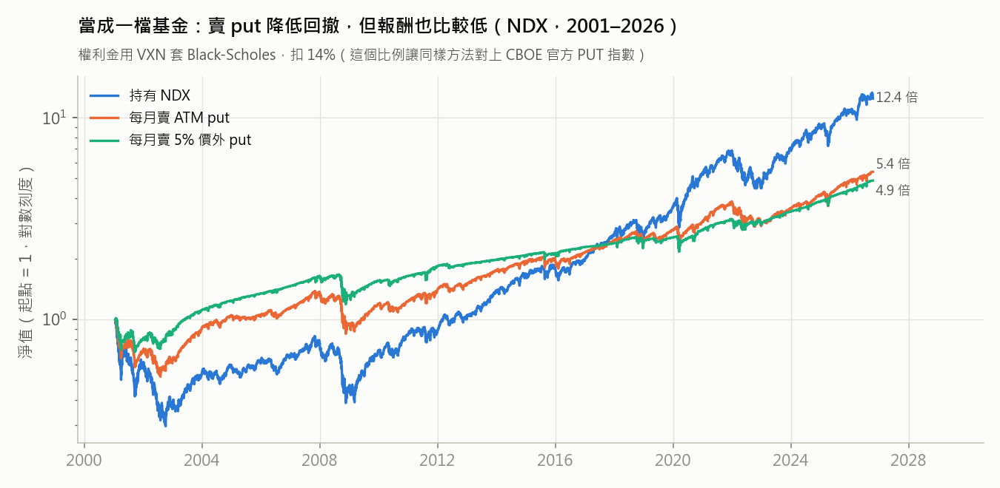
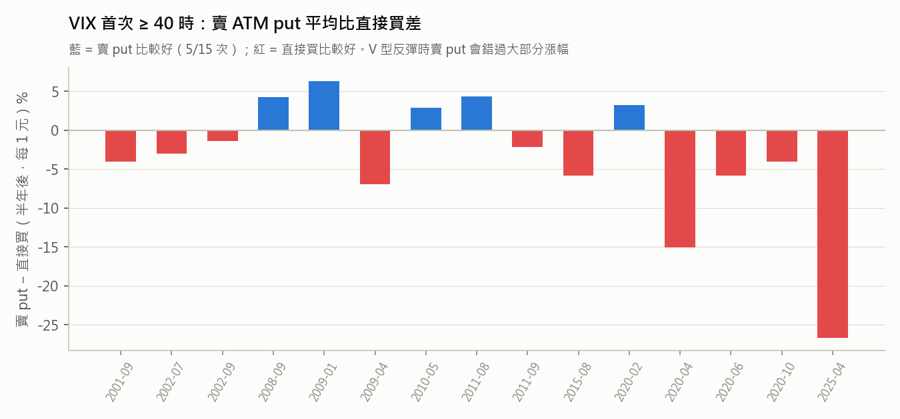

# 賣 put（cash-secured put）對 QQQ 累積者有沒有幫助（補充研究）

**日期：** 2026-10-21 ・ **程式：** `research/run_csp.py`、`research/lib/options.py`（測試：`research/tests/test_options.py`）
**性質：** 歷史統計，不是投資建議。稅務與選擇權的適用性請自行確認。

## 結論

**不建議用賣 put 取代直接買。**

| 用法 | 結果（NDX，2001–2026，權利金已校準） |
|---|---|
| 每月新錢改成賣 put，等被指派才買 | 全期和直接買差不多（期末財富 −0.1%～+0.2%）。2001–2012 小贏（+0.1%～+3.4%），2013 年後小輸（−1%～−10%）。滾動 10 年的窗口裡，只有 7–20% 贏過直接買 |
| 當成一檔「每月賣 put」的基金 | 年化 6.4%～6.8%，直接持有 NDX 是 10.3%；最大回撤 −32%～−48%，直接持有是 −70%。等於「持股比較少」，不是多賺 |
| 全面恐慌（VIX 首次 ≥ 40）時改賣 put | 半年後平均比直接買**少 3.6%～5.1%**，15 次裡只有 5–6 次比較好。V 型反彈時會錯過大部分漲幅（2020-04 少 15%，2025-04 少 27%） |

所以手冊第 5 節的做法改成：**不要用賣 put 等便宜價**。想降低波動，直接把股票比例調低比較簡單。

## 怎麼算的

沒有免費的 QQQ／NDX 選擇權歷史報價，所以權利金是估出來的：

- **定價**：Black-Scholes，波動率用 VXN（NDX 的 30 天隱含波動，Yahoo `^VXN`，2001 年起），價外的 put 再加偏斜（5% 價外 +2 個波動點）。利率用前一天的 3 個月國庫券，NDX 股息率 0.7%。
- **節奏**：每月第一個交易日收盤，賣出到下個月第一個交易日到期的 put；到期時價格低於履約價就照履約價買進（被指派），否則繼續滾下一個月。賣出的 put 張數，剛好讓現金足夠在被指派時全部買進（cash-secured）。
- **校準**（這一步最重要）：
  - 先用同一套方法（VIX 加 S&P 500）重建 CBOE 官方的 S&P 500 賣 put 指數（PUT，1996–2026）。
  - 不扣成本時，模型年化 12.9%，官方 PUT 指數只有 8.6%。也就是說，用 VIX 套公式會**高估**權利金（VIX 本身含有價外 put 的偏斜、實際成交也有價差）。
  - 理論權利金要扣 **14%**，模型才對得上官方指數。月報酬的相關係數是 0.83。
  - 所以 NDX 的結果用「扣 14%」當主要設定，「扣 10%」當偏樂觀的對照。兩者結論相同。



## 詳細結果

**每月存 1 元：賣 put 等指派 vs 直接買**（期末財富比值，> 1 代表賣 put 比較好；權利金扣 14%）

| 做法 | 2001–2026 | 2001–2012 | 2013–2026 | 滾動 10 年：贏的比例 ／ 中位數 | 被指派的月份 |
|---|---|---|---|---|---|
| ATM，一直等到被指派 | 1.002 | 1.005 | 0.990 | 7% ／ 0.990 | 40% |
| ATM，最多等 3 個月就直接買 | 0.999 | 1.001 | 0.990 | 7% ／ 0.992 | 40% |
| 5% 價外，一直等 | 0.999 | 1.034 | 0.897 | 20% ／ 0.930 | 15% |
| 5% 價外，最多等 3 個月 | 1.002 | 1.006 | 0.982 | 7% ／ 0.986 | 14% |

為什麼差不多：被指派的時候是用比較高的履約價買到已經跌下來的股票，收到的權利金大致只抵掉這個損失。沒被指派的月份，錢在等，就錯過了上漲。這和主報告的發現一樣：**「等」本身就有成本**。

**恐慌時（VIX 首次 ≥ 40）用 1 元現金**：直接買 vs 每月賣 ATM put（被指派就持有），半年後的差距。



賣 put 只有在「恐慌後還繼續跌」時比較好（2008-09、2009-01）；遇到 V 型反彈，put 不會被指派，只拿到權利金，等於錯過反彈。歷史上 VIX ≥ 40 之後大多是反彈，所以平均起來是直接買比較好。

## 限制

- 權利金是估算的，不是真實成交價。已經用 CBOE 官方 PUT 指數校準，但校準的是 S&P 500，套到 NDX 是假設兩者的偏差類似。
- 只測了每月滾動的 1 個月 put、ATM 和 5% 價外兩種履約價。沒有測週選擇權、更遠的價外、或「wheel」（被指派後再賣 call）。
- 沒有計入稅。選擇權權利金和股票資本利得的課稅方式可能不同，非美國居民的處理更要自己確認。
- 保證金：這裡假設全額現金擔保，沒有用槓桿。

## 重現

```bash
PYTHONUTF8=1 .venv/Scripts/python research/tests/test_options.py
PYTHONUTF8=1 .venv/Scripts/python research/run_csp.py
```

輸出在 `research/results/csp_*.csv`。需要 `research/raw/prices/IDX_VXN.csv`、`IDX_PUT.csv`（`fetch_data.py` 的 prices 清單已加入 `^VXN`、`^PUT`）。
